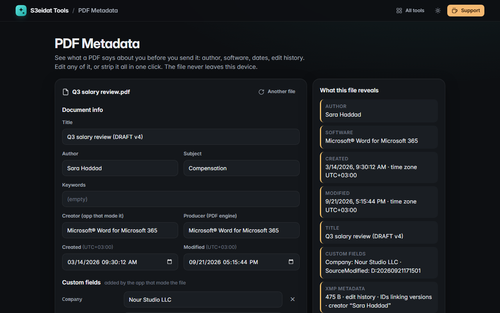

# PDF Metadata

> See and remove the hidden info inside a PDF: author, software, dates, XMP, custom fields. Edit any of it or strip everything in one click. Free, private, and it runs entirely in your browser.

### ▶ [Open PDF Metadata](https://s3eidat.github.io/pdf-metadata/)



## Features

- Shows **title, author, subject, keywords, creator, producer**, **created / modified dates** (with the time zone they reveal), page count, PDF version and size
- Lists **custom fields** other apps add (company name, source dates…), each editable or removable
- Detects **XMP metadata** (with edit history and version IDs) and lets you read the raw XML
- Shows the **document ID** fingerprint that can link copies and versions of a file
- **Edit** any field; only what you change is rewritten
- **Strip everything** in one click: every info field, the XMP stream (document and page level) and the document ID
- The saved file is **rewritten from scratch**: orphaned leftovers of earlier edits that were still hidden in the file are dropped
- "What this file reveals" summary, and a short explainer of why it matters

## Limits

- Pictures inside the PDF can carry their own camera data (EXIF); this tool doesn't rewrite images.
- Password-protected or encrypted PDFs can't be rewritten here; remove the protection first.

## Privacy

Your PDF never leaves your device. There is no server, no account, no analytics.
The page ships with a strict Content-Security-Policy (`connect-src 'self'`), so the browser
itself blocks any attempt to send data anywhere. Files are read and rewritten with [pdf-lib](https://github.com/Hopding/pdf-lib) (MIT), included in `lib/`.

## Run it yourself

It's plain HTML, CSS and JavaScript with no build step:

```bash
git clone https://github.com/s3eidat/pdf-metadata
cd pdf-metadata
python -m http.server 8000
```

Then open http://localhost:8000.

## Support

If this saved you time, **[buy me a coffee ☕](https://s3eidat.github.io/coffee/)**. It keeps every tool free.

---

Part of **[S3eidat Tools](https://s3eidat.github.io/)**: 100+ free, private tools that run in your browser. MIT licensed.
